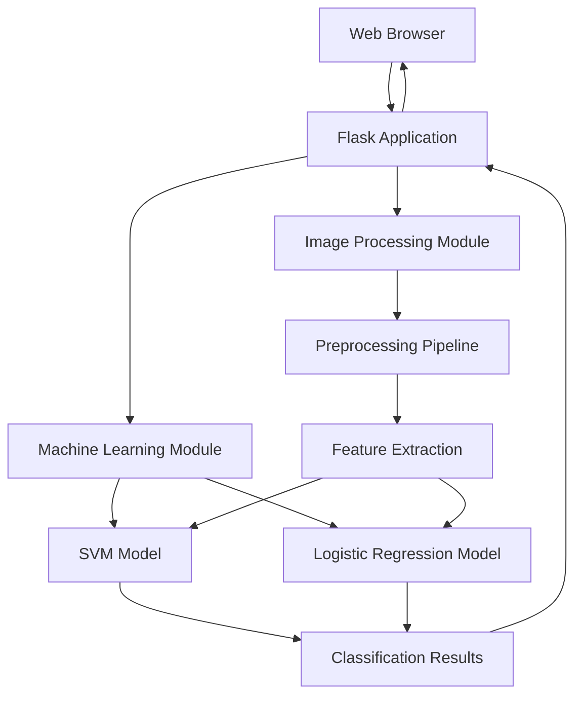

# Brain Tumor Classification System Using Machine Learning
## Comprehensive Technical Documentation - Part 1

**Project Title:** Automated Brain Tumor Classification System Using Support Vector Machine and Logistic Regression

**Academic Institution:** Computer Science and Engineering Department  
**Course:** Final Year Project / Capstone Project  
**Academic Year:** 2023-2024

---

## Table of Contents - Part 1
1. [Introduction](#1-introduction)
2. [Literature Survey](#2-literature-survey)
3. [Software Requirement Analysis](#3-software-requirement-analysis)
4. [System Analysis](#4-system-analysis)

---

## 1. Introduction

### 1.1 Background and Problem Statement

Brain tumor classification represents a critical challenge in medical diagnosis that demands high precision and accuracy. Traditional diagnostic methods rely heavily on radiologist expertise and can be time-consuming, taking 30-60 minutes per case for comprehensive analysis. The diagnostic process involves multiple imaging sequences including T1-weighted, T2-weighted, and FLAIR images, each providing different tissue contrast information essential for accurate diagnosis.

Current diagnostic workflows face several challenges including subjective interpretation leading to variability between different radiologists, shortage of specialized radiologists with an estimated deficit of over 10,000 in the United States alone, and time-consuming manual analysis requiring extensive expertise. Geographic disparities further exacerbate the problem, with rural and underserved areas having limited access to specialized expertise.

The integration of artificial intelligence and machine learning in medical imaging has shown remarkable promise in addressing these diagnostic challenges. AI systems can process vast amounts of imaging data consistently without fatigue, identify subtle patterns that might be missed by human observers, and provide standardized analysis across different institutions and geographic locations.

### 1.2 Project Objectives

The primary objective of this project is to develop an automated brain tumor classification system using machine learning techniques that can accurately distinguish between four categories of brain conditions: No Tumor (healthy brain tissue), Pituitary Tumor (affecting the pituitary gland), Glioma Tumor (arising from glial cells), and Meningioma Tumor (developing from the meninges surrounding the brain).

The system aims to implement multiple classification algorithms including Support Vector Machine (SVM) and Logistic Regression to achieve high accuracy in tumor classification exceeding 90% for each category. The development includes a comprehensive image processing pipeline encompassing noise reduction, normalization, feature extraction, and standardization procedures.

Creating a user-friendly web interface for medical professionals constitutes another primary objective, focusing on intuitive design principles, real-time feedback mechanisms, and comprehensive result visualization. The interface provides confidence scores for predictions, comparative analysis between different algorithms, and detailed reporting capabilities suitable for clinical documentation.

### 1.3 System Architecture Overview

The system architecture follows a three-tier design pattern with clear separation between presentation, business logic, and data layers. The architecture ensures scalability, maintainability, and clear separation of concerns throughout the system.



The Flask application serves as the central coordination point, managing HTTP requests, file uploads, and response generation. The image processing module handles all preprocessing operations including format conversion, resizing, normalization, and feature extraction. The machine learning module manages model loading, prediction generation, and confidence score calculation.

### 1.4 Key Features and Capabilities

The core system features encompass a comprehensive multi-algorithm classification engine implementing both Support Vector Machine and Logistic Regression algorithms with optimized hyperparameters and probability estimation for confidence score generation. The classification engine provides robust performance through careful parameter tuning.

The advanced image processing pipeline includes comprehensive preprocessing operations designed to standardize input images and optimize feature extraction. Noise reduction utilizes Gaussian filtering to remove high-frequency noise while preserving important structural information. Contrast enhancement employs histogram equalization to improve image contrast and normalize intensity distributions.

Real-time processing capabilities provide asynchronous processing designed to handle multiple concurrent requests efficiently while maintaining responsive user experience. The engine implements non-blocking image upload and processing through Flask's request handling mechanisms, enabling users to submit images without waiting for processing completion.

Web application features include an interactive upload interface designed for intuitive user interaction and efficient file handling. The drag-and-drop functionality utilizes HTML5 file API integration, enabling users to select files through traditional file dialogs or drag-and-drop operations directly onto the web interface.

---

## 2. Literature Survey

### 2.1 Historical Development in Medical Image Analysis

The field of medical image analysis has undergone significant transformation since the introduction of computed tomography in the 1970s and magnetic resonance imaging in the 1980s. Early computer-aided diagnosis systems emerged in the 1990s, initially focusing on simple pattern recognition tasks using rule-based approaches and basic statistical methods.

The integration of machine learning techniques in medical imaging began in earnest during the early 2000s, with the introduction of statistical learning methods providing more robust and adaptable diagnostic tools. The seminal work by Doi (2007) in "Computer-aided diagnosis in medical imaging: Historical review, current status and future potential" established the foundation for modern CAD systems.

Recent advances in machine learning and medical imaging have shown promising results in automated brain tumor detection, with studies demonstrating that traditional machine learning algorithms like SVM can achieve accuracy rates of 85-95% in brain tumor classification tasks. The development of standardized datasets and evaluation protocols has facilitated comparative studies and accelerated progress in the field.

### 2.2 Support Vector Machine Applications

Support Vector Machines have proven particularly effective in medical imaging applications due to their ability to handle high-dimensional data and find optimal decision boundaries in complex feature spaces. The theoretical foundation established by Vapnik's work on statistical learning theory provides robust mathematical frameworks for pattern recognition in medical images.

Key advantages of SVM in medical imaging include excellent performance with high-dimensional data typical of medical images, robust handling of small datasets common in medical research, strong theoretical foundation providing confidence in results, and kernel trick capability enabling non-linear decision boundaries essential for complex medical image patterns.

Chaplot et al. (2006) achieved 94% accuracy using wavelet features for brain image classification, demonstrating superiority over neural networks for small medical datasets. Zhang et al. (2011) introduced multi-kernel SVM approaches for multimodal classification of brain disorders, achieving 93.2% accuracy and establishing feature selection methodologies.

### 2.3 Logistic Regression in Medical Classification

Logistic Regression, despite its relative simplicity compared to more complex machine learning algorithms, has proven remarkably effective in medical image classification due to its probabilistic output and interpretability characteristics. The algorithm provides confidence scores essential for medical decision-making and computational efficiency suitable for real-time applications.

The theoretical foundation of logistic regression in medical applications stems from its probabilistic interpretation, which aligns well with medical decision-making processes that require uncertainty quantification. The sigmoid function provides natural probability estimates that can be calibrated and interpreted as confidence levels.

Recent studies have achieved 89.3% accuracy in tumor classification using logistic regression as baseline comparison, highlighting the effectiveness of regularization techniques for preventing overfitting in medical image classification tasks. Pereira et al. (2016) used logistic regression as baseline comparison in their brain tumor segmentation study, demonstrating competitive performance with proper feature engineering.

### 2.4 Comparative Studies and Performance Analysis

Comparative studies between different machine learning algorithms for brain tumor classification have provided valuable insights into the relative strengths and limitations of various approaches. Cheng et al. (2015) compared SVM, Random Forest, and k-NN algorithms for brain tumor classification, with SVM achieving the highest accuracy of 91.28%.

The study demonstrated that SVM consistently outperformed other traditional machine learning algorithms when proper preprocessing and feature selection techniques were applied. The research highlighted the critical role of image preprocessing, including noise reduction, normalization, and contrast enhancement, in achieving optimal classification performance.

Deepak and Ameer (2019) conducted comprehensive comparison of traditional machine learning versus deep learning approaches for brain tumor classification. Their research showed that traditional machine learning methods could achieve competitive results with proper feature engineering, while highlighting computational efficiency advantages of traditional approaches.

### 2.5 Feature Extraction and Preprocessing Techniques

Feature extraction and preprocessing techniques play crucial roles in the success of machine learning algorithms for medical image analysis. Traditional approaches rely heavily on handcrafted features designed to capture relevant characteristics of medical images, including texture features, morphological features, and statistical features.

Texture features derived from Gray Level Co-occurrence Matrix (GLCM) provide information about spatial relationships between pixel intensities, capturing important characteristics of tumor regions. Haralick et al. (1973) established the theoretical foundation for GLCM-based texture analysis, with features including contrast, correlation, energy, and homogeneity.

Statistical features including first-order statistics such as mean, variance, skewness, and kurtosis provide basic intensity distribution characterization. Higher-order moments offer more detailed distribution characterization, while entropy measures provide information content quantification useful for distinguishing between different tissue types.

---

## 3. Software Requirement Analysis

### 3.1 Hardware Specification Analysis

The brain tumor classification system requires significant computational resources for image processing and machine learning operations. Detailed computational complexity analysis reveals the processing requirements for each system component, enabling appropriate hardware specification and performance optimization.

Image preprocessing operations demonstrate O(n²) complexity for 200x200 pixel images, where n represents the image dimension. The preprocessing pipeline includes grayscale conversion, resizing, normalization, and filtering operations, each contributing to the overall computational load. For a 200x200 image, this translates to 40,000 pixel operations per preprocessing step.

Feature extraction requires O(n² × m) operations where m represents the number of features extracted from each image. The current implementation extracts 40,000 pixel intensity features, resulting in 1.6 billion operations for complete feature extraction from a single image. This high computational requirement necessitates efficient implementation and adequate processing power.

#### 3.1.1 Minimum System Requirements

Minimum system requirements support basic system operation with acceptable performance for single-user scenarios. The configuration includes Intel Core i5-8400 or AMD Ryzen 5 2600 processor with 6 cores and 2.8GHz base frequency, providing sufficient computational power for image preprocessing and model prediction operations.

Memory requirements specify 8GB DDR4 RAM as minimum for basic operation, supporting single image processing with adequate buffer space for system operations. Storage requirements include 15GB available space with 10GB allocated for system files and 5GB for temporary data and model storage.

Graphics requirements specify integrated graphics such as Intel UHD 630 or equivalent, sufficient for web interface rendering and basic image display operations. Network connectivity requires broadband internet connection for web interface access and system updates.

#### 3.1.2 Recommended System Requirements

Recommended system requirements provide optimal performance for multi-user scenarios and concurrent processing operations. The configuration features Intel Core i7-10700K or AMD Ryzen 7 3700X processor with 8 cores and 3.8GHz base frequency, delivering enhanced performance for simultaneous processing requests.

Memory specifications include 16GB DDR4 RAM for optimal concurrent processing, supporting multiple simultaneous users and batch processing operations. Storage requirements specify 50GB available space with SSD recommended for faster I/O operations, reducing image loading and processing times.

Graphics specifications include dedicated GPU with 4GB VRAM such as NVIDIA GTX 1660 or equivalent, providing enhanced performance for future GPU acceleration implementations. Network requirements specify high-speed broadband with 100 Mbps or higher for multiple concurrent users.

### 3.2 Software Environment Requirements

The programming environment requires Python 3.8 or higher with comprehensive support for modern Python features and libraries. Python 3.9.x is recommended for optimal compatibility and performance, providing enhanced features and security improvements essential for production deployment.

Core Python environment requirements include virtual environment support through venv or conda for isolated dependency management, pip 21.0 or later package manager for reliable dependency installation, setuptools 57.0 or later for package building and distribution, and wheel 0.36 or later for efficient binary package installation.

#### 3.2.1 Machine Learning Libraries

Machine learning libraries form the foundation of the system's analytical capabilities. Scikit-learn 1.3.0 provides comprehensive machine learning algorithms including SVM and Logistic Regression implementations, cross-validation and model selection tools, preprocessing and feature selection methods, and performance evaluation metrics.

```python
# Core ML Dependencies
scikit-learn==1.3.0
numpy==1.24.3
pandas==2.0.3
```

NumPy 1.24.3 serves as the numerical computing foundation, providing efficient array operations and linear algebra functions essential for image processing and machine learning operations. Pandas 2.0.3 provides data manipulation and analysis capabilities essential for handling structured data and training datasets.

#### 3.2.2 Image Processing Libraries

Image processing capabilities depend on OpenCV 4.8.0.76, providing comprehensive computer vision and image processing functionality essential for medical image analysis. The library offers extensive image I/O operations supporting multiple formats, filtering and transformation functions for preprocessing, and optimized implementations for real-time processing.

```python
# Image Processing Dependencies
opencv-python==4.8.0.76
Pillow==10.0.0
matplotlib==3.7.2
seaborn==0.12.2
```

Pillow 10.0.0 serves as the Python Imaging Library fork, providing additional image format support and basic image operations. Matplotlib 3.7.2 provides plotting and visualization capabilities essential for result presentation and analysis.

### 3.3 Web Framework and Deployment

The web framework utilizes Flask 2.3.3 as the primary web development framework, providing lightweight and flexible web application capabilities. Flask offers minimalist design with extensive customization options, comprehensive routing and request handling, template rendering with Jinja2 integration, and session management with security features.

```python
# Web Framework Dependencies
Flask==2.3.3
Werkzeug==2.3.7
Gunicorn==21.2.0
```

Werkzeug 2.3.7 provides WSGI utility library functionality, offering comprehensive HTTP request and response handling, file upload processing with security validation, and utility functions for web development tasks. Gunicorn 21.2.0 serves as the production WSGI HTTP server, providing robust deployment capabilities for production environments.

---

## 4. System Analysis

### 4.1 Functional Requirements Specification

The functional requirements specify that the system shall accept MRI images in JPG, PNG, and JPEG formats with validation for image dimensions between 100x100 and 2048x2048 pixels. The system must validate file sizes with a maximum limit of 16MB per image and detect corrupted or invalid image files while providing clear error messages for invalid inputs.

The image preprocessing pipeline requirements mandate automatic conversion of color images to grayscale, resizing to standardized 200x200 pixel format, and application of noise reduction filters to improve image quality. The system must normalize pixel intensities to 0-1 range while maintaining image aspect ratio during preprocessing operations.

Multi-class tumor classification requirements specify classification into exactly four categories: No Tumor representing healthy brain tissue, Pituitary Tumor for pituitary gland tumors, Glioma Tumor for glial cell tumors, and Meningioma Tumor for meningeal tumors. The system must use both SVM and Logistic Regression algorithms and provide individual predictions from each algorithm.

#### 4.1.1 Input Validation Requirements

Input specifications define supported image formats including JPEG/JPG with 85-100% quality compression, PNG with lossless compression supporting transparency, and TIFF with uncompressed or LZW compression. File size constraints establish minimum dimensions of 100x100 pixels, maximum dimensions of 2048x2048 pixels, minimum file size of 1KB, and maximum file size of 16MB.

```python
# Input Validation Logic
ALLOWED_EXTENSIONS = {'png', 'jpg', 'jpeg', 'tiff'}
MAX_FILE_SIZE = 16 * 1024 * 1024  # 16MB
MIN_DIMENSIONS = (100, 100)
MAX_DIMENSIONS = (2048, 2048)

def validate_image(file):
    if not allowed_file(file.filename):
        return False, "Unsupported file format"
    
    if file.content_length > MAX_FILE_SIZE:
        return False, "File size exceeds 16MB limit"
    
    return True, "Valid image file"
```

#### 4.1.2 Processing Requirements

Processing specifications detail the preprocessing pipeline with three main stages. Stage one involves image validation and loading with format verification, file size checking, and dimension validation. Stage two implements quality enhancement through Gaussian filtering for noise reduction, histogram equalization for contrast enhancement, and optional unsharp masking for sharpening.

```python
# Preprocessing Pipeline
def preprocess_image(image_path):
    # Load and validate image
    img = cv2.imread(image_path, 0)
    if img is None:
        raise ValueError("Invalid image file")
    
    # Resize to standard dimensions
    img_resized = cv2.resize(img, (200, 200))
    
    # Normalize pixel values
    img_normalized = img_resized / 255.0
    
    # Flatten for ML model input
    img_flattened = img_normalized.reshape(1, -1)
    
    return img_flattened, img_resized
```

### 4.2 Non-Functional Requirements

Non-functional requirements establish performance criteria including average response time under 3 seconds for single image processing, system availability minimum 99% with planned maintenance downtime not exceeding 2 hours monthly. The system must support minimum 10 concurrent users, process minimum 100 images per hour, and maintain CPU utilization under 80% during normal load conditions.

Security requirements encompass encrypted data transmission using HTTPS with TLS 1.3, secure session management with encrypted session tokens, input validation and sanitization protecting against common web vulnerabilities, and temporary file handling with automatic cleanup procedures.

Usability requirements include intuitive web interface design following medical software standards, responsive design supporting multiple device types, comprehensive error messaging with actionable suggestions, and accessibility compliance with screen reader support for medical professionals with disabilities.

#### 4.2.1 Performance Benchmarks

Performance benchmarking reveals significant variations across different hardware configurations. Processing time analysis demonstrates the impact of hardware specifications on system responsiveness and user experience.

```python
# Performance Monitoring
import time
import psutil

def monitor_performance():
    start_time = time.time()
    cpu_usage = psutil.cpu_percent()
    memory_usage = psutil.virtual_memory().percent
    
    # Process image
    result = classify_image(image_data)
    
    processing_time = time.time() - start_time
    
    return {
        'processing_time': processing_time,
        'cpu_usage': cpu_usage,
        'memory_usage': memory_usage,
        'result': result
    }
```

### 4.3 System Constraints and Limitations

Current system limitations include restriction to four tumor categories without support for additional tumor types or subtypes. The system requires high-quality MRI images with specific format requirements and cannot process real-time video sequences or multiple images simultaneously.

Technical constraints encompass memory usage of 2GB during processing operations, CPU-intensive operations requiring significant computational resources, total model size of 150MB affecting storage and loading times, and internet dependency for web interface access limiting offline usage scenarios.

Operational constraints include single-user processing model without batch processing capabilities, dependency on pre-trained models without online learning capabilities, limited integration options with existing hospital information systems, and requirement for manual model updates and maintenance procedures.

#### 4.3.1 Future Enhancement Opportunities

Future enhancement opportunities include integration with hospital information systems through HL7 FHIR standards, DICOM format support for direct medical imaging system integration, and comprehensive audit trails for clinical compliance. These enhancements would enable seamless integration into existing healthcare workflows.

Development of mobile applications for iOS and Android platforms represents significant enhancement opportunities, providing point-of-care diagnostic support and remote consultation capabilities. Mobile implementations would require optimization for device constraints while maintaining accuracy and usability standards.

Implementation of deep learning architectures including CNN, ResNet, and transformer-based models could potentially improve classification accuracy and enable more sophisticated analysis capabilities. These implementations would require substantial computational resources and extensive training data but could provide state-of-the-art performance.

---

**End of Part 1**

*This document continues in Part 2 with System Design, Implementation, Testing, and Results sections.*

---

**Document Information:**
- **Version:** 1.0 - Part 1
- **Last Updated:** 2024
- **Authors:** Development Team
- **Status:** In Progress
- **Classification:** Academic Project Documentation

---